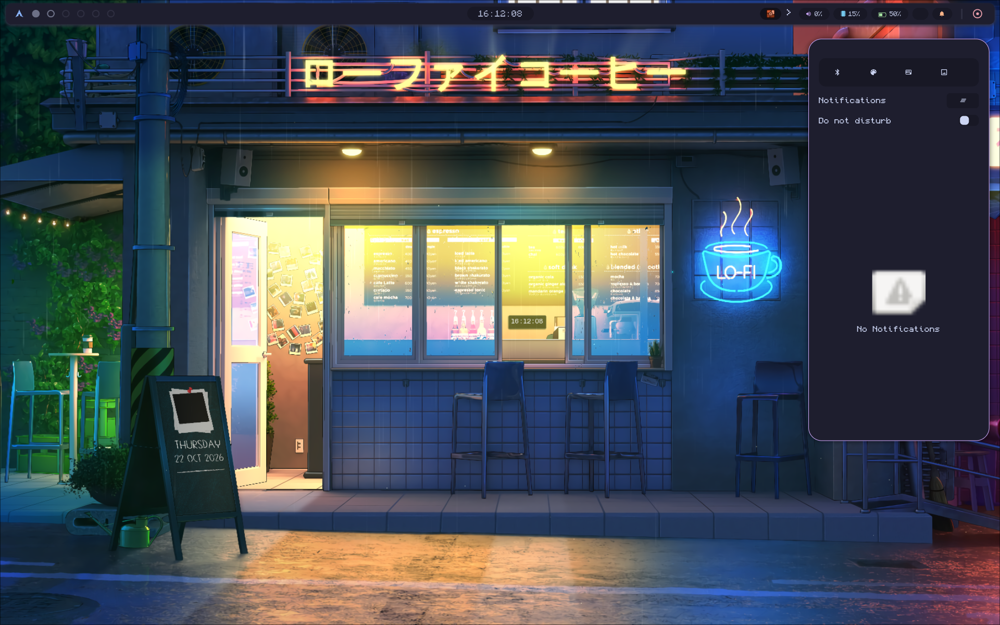
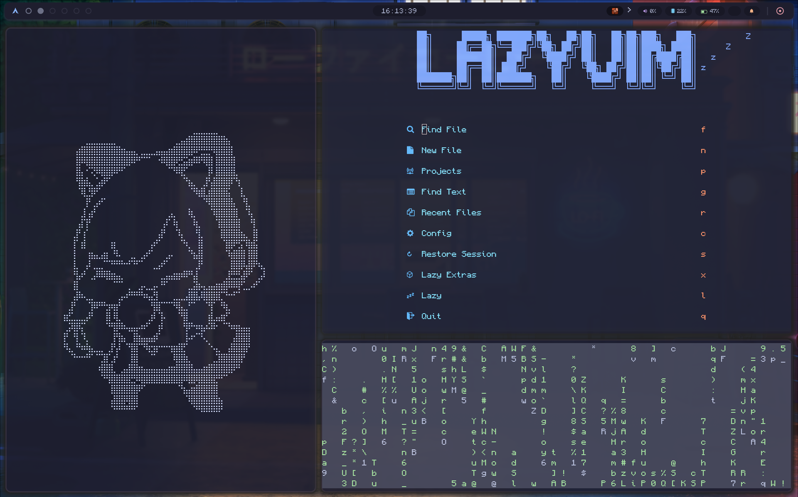

# enderDotFiles 

inspired from [monasm-dots](https://github.com/Mon4sm/monasm-dots)

#### Installation

Just clone this repo and paste in your arch enviroment ".config"

#### Some screenshots btw

PD. I use waywallen for wallpapers and momoisay from "monasm", pls support their <3